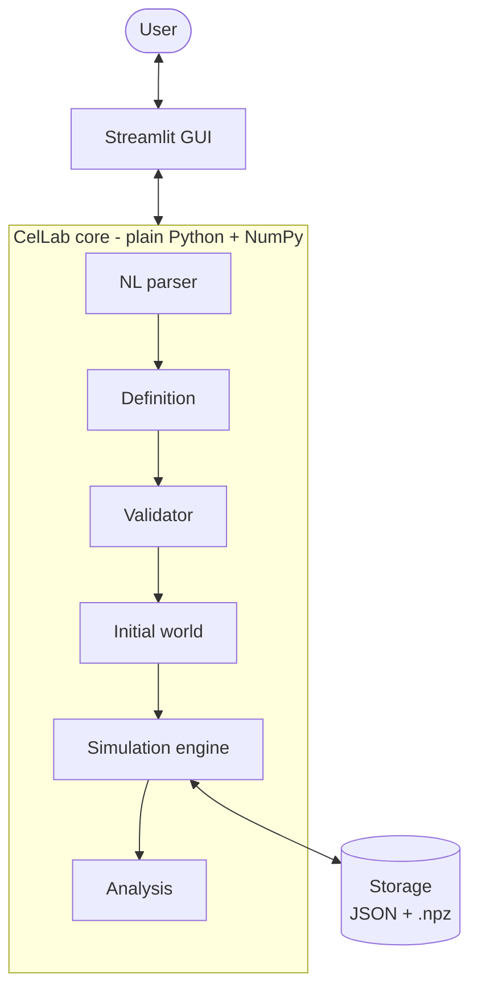

# CelLab

**CelLab** is a cellular automata laboratory: describe a two-dimensional world in plain English -
its size, cell types and evolution rules - and CelLab validates it, simulates it, lets you browse
every generation and answers questions about its behaviour.

> Project for the **Artificial Intelligence** course (Faculty of Computer Science, Ia&#x219;i),
> group 3B4. "AI" here refers to the course: **CelLab itself contains no AI agents or language
> models.** Natural language is interpreted with deterministic rules, regular expressions and
> templates only.

**Status:** in development - currently in **Sprint 2** (see [planning](docs/PLANNING.md)).

## Team

| Member | Group |
| --- | --- |
| Georgic&abreve; D&abreve;nu&#x21B;-Liviu | 3B4 |
| Ghica Alexandra-Mihaela | 3B4 |
| Iacob David-Gabriel | 3B4 |
| Zavincu Sergiu-Constantin | 3B4 |

## Features (planned)

- **Natural-language descriptions** - e.g. *"A dead cell becomes alive if it has exactly 3 alive
  neighbours. An alive cell with fewer than 2 or more than 3 alive neighbours dies."* - parsed
  deterministically into a formal definition you can review and edit before simulating.
- **Validation** with clear errors and warnings (unknown states, impossible conditions, overlapping
  rules).
- **Initial worlds** set by hand, generated randomly (seeded, with probabilities per state) or built
  from patterns - and combinable.
- **Simulation** of any number of generations, with configurable history: keep all, every *k*-th, or
  only the final generation.
- **Analysis - all five questions:**
  1. What is the state after *N* iterations?
  2. When does the system become stable?
  3. Does a particular configuration ever occur?
  4. How many cells of type *X* exist after *N* iterations?
  5. Does the simulation enter a cycle (and with what period)?
- **Save & resume** experiments; every run is reproducible from its definition, seed and parameters.
- **Built-in examples:** Game of Life, Brian's Brain, Rule 30, Cyclic CA, Forest Fire, Voter model,
  Crystal growth, SIR epidemic.
- **NN experiment:** a dataset of generations and a neural network that learns automaton rules.

## Tech stack

| Component | Technology |
| --- | --- |
| Language | Python >= 3.11 |
| Simulation | NumPy |
| Graphical interface | Streamlit |
| Persistence | JSON definitions + compressed NumPy (`.npz`) generation histories |
| Natural-language parsing | Custom deterministic parser (Python `re`, `difflib`, templates, synonym tables) |
| NN experiment | PyTorch (optional, isolated in `experiments/`) |
| Testing / linting | pytest, ruff |

We deliberately replaced the initially proposed FastAPI + React + SQLite stack with a pure-Python
one: a single language, no web API layer and no JavaScript build make the product faster to build
and easier for every team member to work on. The reasoning is in
[docs/DESIGN.md](docs/DESIGN.md#2-technology-choices).

## Architecture



Parsing, validation, simulation and analysis are separate stages. The simulator executes only
validated definitions and never interprets text itself. Details: [docs/DESIGN.md](docs/DESIGN.md).

## Project structure

```text
cel-lab/
|-- src/cellab/
|   |-- model/         # formal automaton definition + validator
|   |-- engine/        # simulation engine + initial-world generation
|   |-- analysis/      # the five analysis questions
|   |-- storage/       # saving / loading definitions, experiments and histories
|   |-- nlp/           # deterministic natural-language parser
|   `-- ui/            # Streamlit application
|-- experiments/       # Deliverable 3: dataset generation + neural-network experiment
|-- examples/automata/ # example definitions and natural-language descriptions
|-- tests/             # pytest suite
|-- data/              # generated runs and datasets (git-ignored)
|-- docs/              # specification summary, design, sprint planning
|-- tools/             # developer tooling: prompt-logging hook, character checker
|-- .claude/           # shared Claude Code settings (permissions, hooks)
|-- .github/           # GitHub Copilot instructions + hooks
|-- .vscode/           # shared VS Code settings and recommended extensions
|-- AGENTS.md          # shared context for all AI coding assistants
|-- CLAUDE.md          # Claude Code entry point (imports AGENTS.md)
`-- PROMPTS.md         # log of every AI interaction (course requirement)
```

## Getting started

Requirements: **Python 3.11+** and **Git**.

```bash
git clone https://github.com/IntCommandNew/cel-lab.git
cd cel-lab
python -m venv .venv
# Windows:
.venv\Scripts\activate
# Linux / macOS:
source .venv/bin/activate

pip install -e ".[dev]"        # application + test tools
pip install -e ".[dev,ml]"     # ... plus PyTorch for the NN experiment
```

### Usage

> The commands below become available as the corresponding sprints are completed.

```bash
streamlit run src/cellab/ui/app.py   # start the graphical interface (Sprint 3)
python -m pytest                     # run the test suite
ruff check . && ruff format .        # lint and format
python tools/check_chars.py          # character rules (keyboard characters only in code/Markdown)
npx markdownlint-cli2 "**/*.md" "#.venv"   # Markdown lint (needs Node.js; same rules as VS Code)
```

Team conventions, including the rule on special characters and emojis, are in
[AGENTS.md](AGENTS.md).

### Working in VS Code

Open the folder in VS Code and install the recommended extensions when prompted (Python, Pylance,
Ruff, Claude Code, GitHub Copilot). Select the `.venv` interpreter. Formatting on save and the
pytest test explorer are preconfigured in `.vscode/settings.json`.

### AI assistant setup (team)

The repository ships the same context and prompt logging for both assistants we use:

| | Claude Code | GitHub Copilot (VS Code) |
| --- | --- | --- |
| Project context | `CLAUDE.md` -> imports `AGENTS.md` | `AGENTS.md` + `.github/copilot-instructions.md` |
| Settings | `.claude/settings.json` | `.vscode/settings.json` (Copilot section) |
| Prompt-logging hooks | `.claude/settings.json` | `.github/hooks/prompt-log.json` |

Both hook configurations run the same script, `tools/prompt_log.py`, which appends every prompt to
`PROMPTS.md` and reminds the assistant to fill in the result. `AGENTS.md` is the single source of
project-wide rules; edit it rather than the assistant-specific files.

**Once per clone**, set the name your log entries are attributed to (stored in the repo's local git
config, so it works for both assistants):

```bash
git config cellab.author "Your Full Name"
```

Without it, your `git config user.name` is used. Restart Claude Code / reload VS Code after pulling
hook changes.

**Copilot notes:**

- Automatic logging works in Copilot Chat **agent mode** (hooks need a recent VS Code + Copilot
  Chat). In ask/edit mode, inline chat, or if the hook didn't run, add the entry to `PROMPTS.md` by
  hand using the template at the top of the file.
- Inline code *completions* (grey ghost text) are not prompts and are not logged one by one; their
  use is covered by the general statement in [Use of AI tools](#use-of-ai-tools).

## Contributing workflow

`main` is protected: every change goes through a pull request, force pushes and deleting `main`
are blocked, and open review conversations must be resolved before merging.

```bash
git checkout main && git pull                # start from the latest main
git checkout -b feature/<short-name>         # or fix/... , docs/...
# ... work, commit (including the PROMPTS.md entries for your prompts) ...
git push -u origin feature/<short-name>      # then open a pull request into main on GitHub
```

After merging, GitHub deletes the branch automatically; locally run `git checkout main`,
`git pull` and `git branch -d feature/<short-name>`.

## Documentation

- [docs/SPECIFICATION.md](docs/SPECIFICATION.md) - summary of the course requirements
- [docs/DESIGN.md](docs/DESIGN.md) - formal model, validation, analysis, parser and experiment
  design
- [docs/PLANNING.md](docs/PLANNING.md) - sprints, dates and task checklists

## Use of AI tools

The course allows - and expects - the use of conversational AI assistants **to develop** the
project, and requires that **every interaction with them is saved**. We use AI assistants (mainly
Claude Code and GitHub Copilot, possibly others) for:

- planning, design discussions and documentation drafts;
- generating and refactoring code, which team members review, test and adapt;
- code completion while typing (GitHub Copilot inline suggestions);
- writing tests and debugging.

All prompts, with their date, author, assistant and a short summary of the result, are recorded in
**[PROMPTS.md](PROMPTS.md)**. For Claude Code and Copilot agent mode this happens automatically
through project hooks; prompts given to other assistants (or in Copilot modes without hooks) are
added manually using the same template.

This assistance is limited to the **development process**. The delivered system **does not call any
online or offline AI agent or language model** - its natural-language parser is entirely rule-based
and deterministic. The only neural network in the repository is the Deliverable 3 experiment in
`experiments/`, which is trained by us and is not used by the application.

## License

[MIT](LICENSE)
