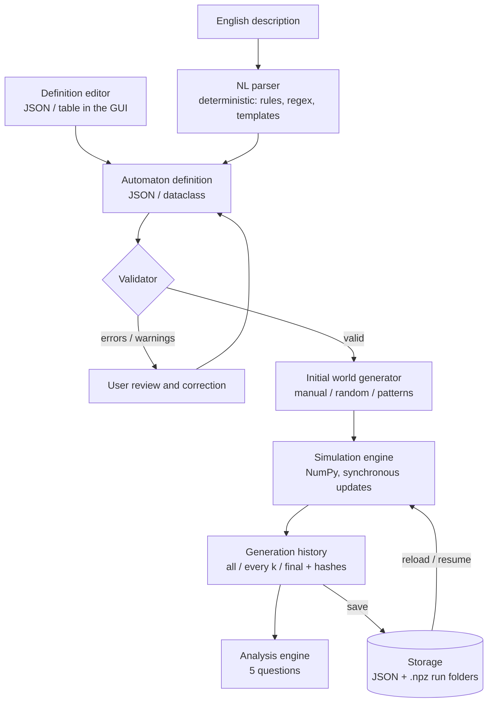

# CelLab - Design

This document records *how* CelLab works and *why* we chose each approach. It started from the
team's Deliverable 1 notes and was revised for simplicity. Anything marked **(draft)** is to be
finalised during the sprint that implements it - update this file when a decision changes.

**Hard constraint:** the final system makes no calls to online or offline agents/LLMs. Natural
language is interpreted with deterministic techniques only (rules, regular expressions, templates,
synonym tables).

## 1. Pipeline overview



Each stage is independent and testable. The simulator only ever sees a **validated definition** - it
never interprets text. The definition is also editable directly (JSON / table in the GUI), so the
project works end-to-end even before the parser is finished (Deliverable 4 comes last).

## 2. Technology choices

| Concern | Choice | Instead of | Why |
| --- | --- | --- | --- |
| Language | Python >= 3.11 | - | Team requirement. |
| Grid computation | **NumPy** | - | Vectorised neighbour counting; a 500x500 grid steps in milliseconds. |
| GUI | **Streamlit** | FastAPI + React | One language, no REST layer, no Node/JS build. Text areas, sliders, charts, image display and session state are built in - exactly what the spec asks for (enter text, set parameters, browse generations). Fallback if we hit its limits: NiceGUI. |
| Persistence | **JSON + compressed `.npz` files** | SQLite | Definitions are small documents (JSON is human-readable and diff-able in git); histories are arrays (`numpy.savez_compressed` stores uint8 grids very compactly). One folder per run = a self-contained, reproducible experiment. No schema/ORM to maintain. |
| NL parsing | **Hybrid rule/regex/template parser, stdlib only** (`re`, `difflib`) | NLP libraries | Deterministic, testable, no model downloads. `difflib` gives "did you mean..." suggestions. |
| NN experiment (D3) | **PyTorch** (optional `ml` extra, `experiments/` only) | - | A 3x3 convolution is the natural model of a CA neighbourhood. Kept out of the app's dependencies. |
| Quality | **pytest**, **ruff** | - | Fast, zero-config. |

## 3. Automaton model

### Scope

**Core (must have):** finite 2D grids (1D = one row), a fixed set of named discrete states, a
uniform neighbourhood, synchronous updates, rules of the form *"a cell in state A becomes B if a
condition on neighbour counts holds"*. This covers Game of Life, Brian's Brain, Cyclic CA, Forest
Fire, deterministic SIR epidemic, Voter model, Crystal growth, and - via a lookup rule - elementary
automata like **Rule 30**.

**Extensions (planned):** probabilistic rules (`with probability p`, seeded RNG) for stochastic
Forest Fire / SIR. **Stretch (only if time allows):** Langton's Ant, Sandpile, Heat diffusion (need
agents or numeric cells). **Out of scope:** agents with memory/energy/movement (Predator-Prey,
Schelling, Falling sand, Ecosystem).

### Definition format

Implemented in `cellab.model` (dataclasses in `definition.py`, checks in `validate.py`). Presets in
`src/cellab/presets/` are complete examples.

```json
{
  "name": "Game of Life",
  "description": "Optional text shown with the automaton.",
  "grid": { "width": 40, "height": 30, "boundary": "wrap" },
  "states": [
    { "name": "dead", "symbol": ".", "color": "#F3F5F8" },
    { "name": "alive", "symbol": "#", "color": "#2E2A5C" }
  ],
  "default_state": "dead",
  "neighborhood": { "type": "moore", "radius": 1 },
  "rules": [
    { "from": "alive", "to": "dead", "when": { "count": "alive", "not_in": [2, 3] } },
    { "from": "dead", "to": "alive", "when": { "count": "alive", "eq": 3 } }
  ]
}
```

- **Grid:** `width` and `height` from 1 to 1000. `boundary` is `"wrap"` (edges join up, the
  default) or `{"fixed": "<state>"}` (cells outside the grid count as that state).
- **States:** 1 to 256, each with a unique `name` (not `any`), a unique one-character `symbol`
  (visible keyboard character, used in text grids) and a `color` (`#RRGGBB`). `default_state`
  fills empty cells.
- **Neighbourhood:** `moore` (8 cells at radius 1), `von_neumann` (4), `elementary` (left and
  right cell, 1D); `radius` 1 to 5 (default 1). Neighbourhood size: Moore `(2r+1)^2 - 1`,
  von Neumann `2r(r+1)`.
- **Rules:** `from` is a state, a list of states, or `"any"` (the default when omitted); `to` is
  required; `when` is optional (default `"always"`); `probability` is optional (0 < p <= 1).
- **Conditions:** `{"count": <state or list of states>, <op>: <value>}` with one op:
  `eq / ne / lt / le / gt / ge` (whole number), `in / not_in` (list), `between` (`[low, high]`,
  inclusive); combinators `{"all": [...]}`, `{"any": [...]}`, `{"not": {...}}`; or `"always"`.
- **Elementary rules:** `{ "kind": "elementary", "code": 30 }` must be the only rule, with two
  states (0 and 1, in order), the `elementary` neighbourhood and grid height 1.
- **Templates such as Cyclic CA** ("x becomes (x+1) mod k") are expanded into one concrete rule per
  state by the parser/presets, so the engine stays simple.
- Unknown fields are reported as warnings and ignored.

### Semantics (explicit, no hidden cases)

1. Rules are checked **in order**; the **first** rule whose `from` matches the cell and whose
   condition holds decides the new state.
2. A **probabilistic** rule decides the cell only when its random draw succeeds; otherwise the next
   rules are still considered. Draws come from a seeded generator, so runs are reproducible.
3. A cell matched by **no rule keeps its state.**
4. All conditions are evaluated on the **previous generation** (synchronous update;
   order-independent).
5. Grid cells store state **indices** (`uint8`); names/symbols/colours are presentation only.

## 4. Validation

Parsing and validation are separate: a sentence that matches a template can still yield an invalid
automaton. The validator returns a list of **errors** (block simulation) and **warnings** (shown to
user).

1. **Structural** - required fields present, types correct, grid size within limits.
2. **Reference** - rules only use declared states; the neighbourhood type is supported.
3. **Semantic** - impossible counts (e.g. "exactly 9 neighbours" with Moore r=1) -> error;
   overlapping rules for the same state (first wins) -> warning; rules fully shadowed by earlier
   ones -> warning; probabilities outside [0, 1] -> error; states that are never reachable -> info.
4. **User confirmation** - the GUI shows the interpreted definition as a table *and* as canonical
   English re-generated from the definition, so the user can see exactly what will be simulated.

## 5. Initial world

- **Manual:** a text grid using the state symbols (e.g. `. . F . .`, spaces optional), editable in
  the GUI. It may be smaller than the grid: it is placed at a given row/column, or centred on cell
  `(height // 2, width // 2)`, with the default state everywhere else.
- **Random:** each cell gets a state with given probabilities (the rest goes to the default
  state), from an explicit `seed`.
- **Centre cell:** the default world with one cell of a chosen state at `(height // 2,
  width // 2)`, e.g. Rule 30's starting row.
- **Patterns:** named patterns (single centre cell, glider, blinker, ...) placed at coordinates on
  top of a background (default state or random).
- Combinable: generate, then edit by hand. The result must match the grid size and declared states.

## 6. Simulation & history

- The engine computes per-state neighbour-count arrays with `np.roll` (wrap) or padding (fixed
  boundary), then applies rule masks in order. A new generation never reads cells already updated in
  the same step.
- **Generations computed != generations stored.** History modes: `all`, `every k` (checkpoints),
  `final`.
- Every generation's hash (`blake2b` of the grid bytes) is recorded regardless of history mode, so
  stability and cycle detection work even when intermediate states are not kept.

## 7. Analysis questions - we support all five

| Question | Method | Notes |
| --- | --- | --- |
| State after *N* | Simulate to *N*. If a cycle (start &mu;, period &lambda;) was found earlier, jump: state(N) = state(&mu; + (N - &mu;) mod &lambda;). | Large *N* becomes cheap once a cycle is known. |
| When is it stable? | First generation *t* with state(t+1) = state(t) (a cycle of period 1). | "Not found within limit" != "never". |
| Does configuration *P* occur? | Whole-world match, or sub-pattern search with `sliding_window_view` (wrap-aware), `?` wildcard; optional rotations/reflections. | Report the first generation and position. |
| How many cells of type *X* after *N*? | `count_nonzero(state == X)` on state(N); also a population chart over time. | |
| Does it enter a cycle? | Hash map `hash -> first generation`; on a hit, confirm by comparing actual states (re-simulate if not stored). Report &mu; (transient length) and &lambda; (period). | Finite + deterministic => always eventually cycles; the limit bounds the search. |

Every answer has a status: **confirmed**, **not found within limit** (with the limit), or **not
applicable** (e.g. stability/cycles on a stochastic automaton - reported only as "observed in this
seeded run").

## 8. Storage & recovery

```text
data/runs/2026-11-06_1530_game-of-life/
|-- definition.json     validated automaton definition
|-- experiment.json     grid source, seed, generations, history mode, timings, analysis answers
`-- history.npz         stored generations (uint8) + generation indices + hashes
```

A run can be reloaded to browse it, re-run analyses, or **resume** simulation from its last stored
state. Example definitions and NL descriptions are versioned in `examples/automata/`.

## 9. Natural-language parser (Deliverable 4, draft)

Users write ordinary English sentences from a documented, growing set of supported patterns.

1. **Normalise** - lowercase, unify punctuation, number words -> digits ("three" -> 3),
   British/American spellings, verb synonyms ("turns into", "changes to", "will be" -> *becomes*),
   state-name synonyms ("live", "living" -> *alive*) derived from the declared states.
2. **Split** into sentences/clauses.
3. **Match templates** - an ordered list of regexes with named groups, grouped by family:
   - *world:* "the grid is 40 by 30", "edges wrap around", "cells outside the grid are dead"
   - *states:* "cells can be dead or alive", "there are three cell types: off, firing and dying"
   - *neighbourhood:* "the eight surrounding cells", "only the four orthogonal neighbours"
   - *rules:* "a dead cell becomes alive if it has exactly 3 alive neighbours", "firing cells become
     dying", "an alive cell survives with 2 or 3 alive neighbours", "otherwise it dies", "... with
     probability 0.01"
   - *conditions:* exactly / at least / at most / more than / fewer than / between N and M / N or M
     / no / any
   - *presets:* "Conway's Game of Life", "elementary rule 30", "Brian's Brain" -> known definitions
   - *initial world:* "start with 20% alive cells at random", "one alive cell in the centre"
4. **Assemble** a definition. Only documented settings get defaults (grid size, boundary,
   neighbourhood), and every applied default is reported. **Rules are never invented.**
5. **Report** unmatched sentences with the closest supported template (`difflib`) instead of
   guessing.
6. **Validate** (section 4) and show the canonical re-generated English for confirmation.

Testing: a corpus of description -> expected-definition pairs, plus a round-trip property
(definition -> canonical English -> parse -> same definition).

## 10. Neural-network experiment (Deliverable 3, draft)

- **Dataset:** for several automata (Life, Brian's Brain, Cyclic, Rule 30), random worlds with
  varied densities and seeds -> simulate -> pairs `(state_t, state_t+1)`; saved as `.npz` with
  metadata, generated by a seeded script so it is reproducible. Optionally a Q/A set (initial world
  -> "stabilises within N?", "period?") produced by the analysis engine.
- **Experiment:** a small CNN (3x3 convolution + 1x1 layers, one-hot state input) learns the
  transition rule. Metrics: per-cell accuracy, whole-grid exact match, multi-step rollout accuracy.
  Baselines: "copy previous state", majority state. Compare difficulty across automata.
- Lives in `experiments/`; the app does not depend on it.

## 11. Main decisions (summary)

| Decision | Choice |
| --- | --- |
| Natural language | Hybrid deterministic parser (rules + regex + templates + synonyms) |
| Rule expressiveness | Neighbour-count rules over named states + elementary lookup rules (+ probability) |
| Initial state | Manual, random and patterns - combinable |
| History | Configurable: all / every k / final, hashes always kept |
| Analysis | All five questions |
| Scope | Finite, synchronous grids with explicit boundaries; agents/numeric cells only as stretch goals |
| Stack | Python, NumPy, Streamlit, JSON + npz files, pytest, ruff; PyTorch only for D3 |
